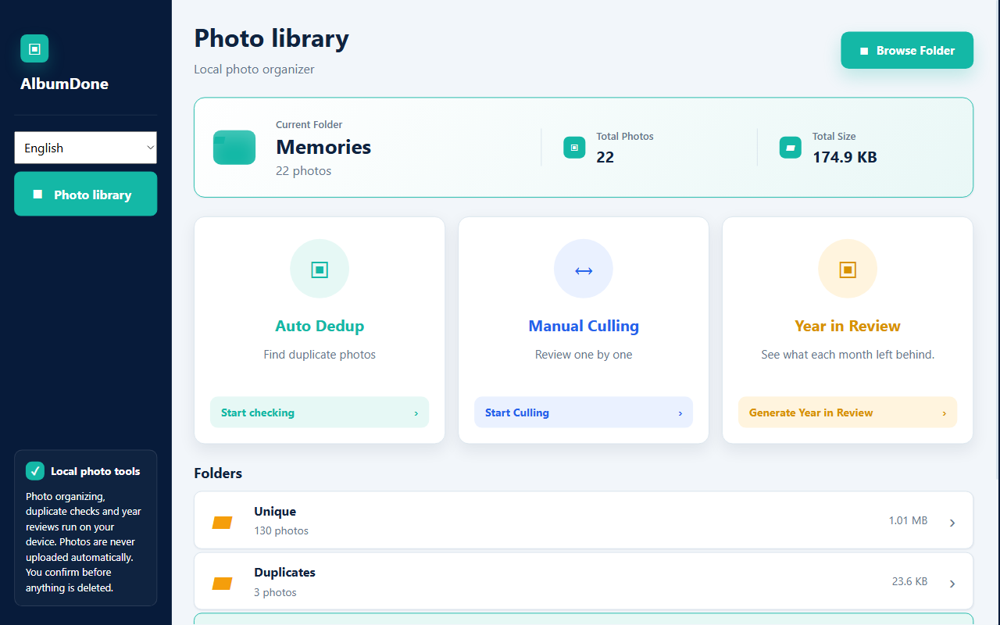

[English](README.md) | [简体中文](README.zh-CN.md)

# AlbumDone

Organize your photos on your own computer. AlbumDone is a free, open-source Windows photo organizer by **Link Vector Pty Ltd**, with duplicate review, manual review and Year in Review. Photo processing runs locally, without an account or uploading your library.

## Product preview

The Windows desktop interface with a demo photo library. See the [Chinese interface](README.zh-CN.md#产品截图).

## What you can do

- **Review similar photos:** compare grouped photos, choose which to keep, or keep the whole group. A large preview lets you inspect a photo before deciding.
- **Sort photos manually:** browse with Previous/Next buttons or keyboard shortcuts, mark photos to keep or delete, and undo review decisions. Continue through a folder in batches.
- **Create a Year in Review:** choose the past twelve months or last calendar year, pick a photo for each month, and save your selection as a JPG.

The app includes fifteen interface languages, thumbnails, local review-progress recovery and a Windows Recycle Bin option. The current desktop version uses local photo processing and does not include AI features.

## Version and downloads

The current source version is **0.2.2**, targeting **Windows x64**. A 0.2.2 installer has not yet been published to GitHub Releases. The existing [v0.1.2-beta.10 download](https://github.com/BlueVenn6/AlbumDone/releases/tag/v0.1.2-beta.10) is an older prerelease and does not contain the current version's changes.

The 0.2.2 installer recorded in the [changelog](CHANGELOG.md) is unsigned. Its packaged application has been tested; system installation and upgrades remain unverified. See the changelog for checksums and validation scope, and the [code signing policy](CODE_SIGNING_POLICY.md) for signing status.

## Getting started

1. Choose a local photo folder.
2. Open Auto Dedup, Manual Culling or Year in Review.
3. Review your choices before confirming deletion, or save your Year in Review image.

Marking a photo for deletion does not delete it immediately. Similarity suggestions need your review. Keep a backup of important photos; permanent deletion cannot be undone in AlbumDone. See the [user guide](docs/USER_GUIDE.md) for batch behavior, controls and file operations.

## Help and privacy

- [Product website](https://linkvectorapp.com/albumdone)
- [Support](https://linkvectorapp.com/albumdone-support) · [info@linkvectorapp.com](mailto:info@linkvectorapp.com)
- [Privacy policy](PRIVACY.md) · [File-operation notice](DISCLAIMER.md)
- [Report a bug](https://github.com/BlueVenn6/AlbumDone/issues) · [Report a security issue privately](SECURITY.md)

## Build and contribute

For setup, development, testing and packaging, see [Contributing](CONTRIBUTING.md). Technical details are available in [build provenance](RELEASE_SOURCES.md), [performance checks](docs/PERFORMANCE.md) and [screenshot provenance](docs/assets/screenshots/README.md).

License: [MIT](LICENSE).
