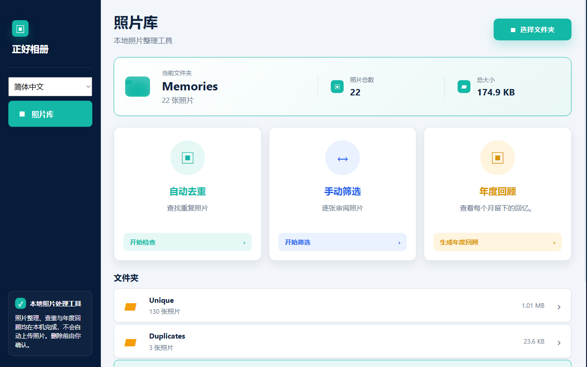

[English](README.md) | [简体中文](README.zh-CN.md)

# 正好相册 AlbumDone

离线 Windows 照片整理工具，当前桌面源码为 **0.2.2 无 AI 版**，使用 MIT 许可证，保留公开仓库历史。

## 产品截图



当前 Windows 桌面界面，取自 0.2.2 安装包内程序，使用独立演示图库。[英文介绍](README.md#product-preview)展示英文界面。截图来源见[此处](docs/assets/screenshots/README.md)。

## 0.2.2 当前状态

[发布记录](CHANGELOG.md)列出 0.2.2 安全维护内容，以及此前 0.2.1 的安装包身份和验收范围。本次源码更新不创建 GitHub Release 或发布签名包；历史 Release 下载仍对应各自标注的旧版本。

0.2.2 安装包**尚未签名**。该确切包内的程序已通过 8 组运行场景验收，包括 15 种语言排版、JPG 导出及合成照片实际删除；发布记录列出源码和 SHA-256。系统安装、覆盖安装和升级尚未验收。SignPath 签名是后续独立的发布步骤，详见[代码签名政策](CODE_SIGNING_POLICY.md)。

0.2.2 锁文件在 2026-11-08 UTC 的完整依赖审计中报告 0 个受影响依赖项，检查包含 Electron 和构建工具；本地 lint、类型及单元/集成检查通过，GitHub 对运行源码的复扫报告 Dependabot 和 CodeQL 开放告警均为 0。验收范围与来源详见[发布记录](CHANGELOG.md)。这些结果不代表不存在任何漏洞。

## 三个主要功能

- **自动去重**：选择检查数量，逐组预览，默认保留一张，可更换保留照片或整组保留；确认后才执行删除。大图只是组内某张照片的预览。检查完成后可返回数量选择，并保留文件夹进度。
- **手动筛选**：单张或网格查看，支持上一张/下一张按钮、标记保留/删除、撤销及键盘操作；浏览照片不会自动标记为已审阅，完成后可选择下一批。
- **年度回顾**：过去十二个月或上一自然年，每月一张，可更换同月候选照片和空月份寄语，保存当前实际选择的 JPG。

内置 15 种语言，可切换。保留文件夹、缩略图、本地任务恢复和回收站功能。本版移除模型设置、模型请求、密钥管理、截图指令和 OCR；照片筛选需要的本地截图文件名识别仍保留。

## 开发、验收与打包

要求 Windows x64、Node 22.23.4、npm 12.2.2 和 Git。完整命令见 [英文说明](README.md)。

```powershell
npm ci
npm run lint
npm run typecheck
npm run test
npm --workspace @photo-manager/desktop run build
npm --workspace @photo-manager/desktop run test:e2e
```

生产界面验收使用人工生成的照片和独立的应用数据目录，不读取真实相册。提交已经测试的源码后，运行：

```powershell
npm --workspace @photo-manager/desktop run package
```

输出位于 `packages/desktop/release`，包含嵌入源码身份的应用、安装器和 SHA-256 构建记录。源码测试、构建、打包与实际安装包验收分别记录，不互相替代。

参见 [0.2.1 发布记录](CHANGELOG.md)、[操作说明](docs/USER_GUIDE.md)、[隐私说明](PRIVACY.md)、[构建来源](RELEASE_SOURCES.md)、[代码签名政策](CODE_SIGNING_POLICY.md)。手机端在独立私有仓库维护。禁止将手机签名材料放入本公开仓库。许可证：[MIT](LICENSE)。
